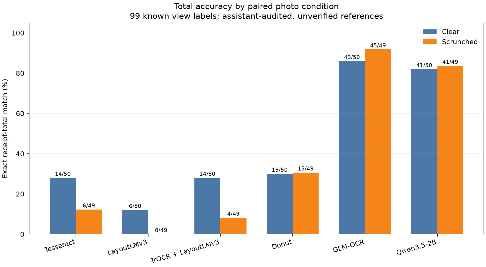

# Receipt-photo evidence note — 7 October 2026

## Scope and reading guide

This is a reproducible count-and-score supplement to the thesis work. It uses saved inference outputs only: **no model was run, no label was edited, and no receipt photo was copied into this package**. The main comparison is the 50-identity paired photo cohort (100 selected views). The 16-receipt item-row set is a subcohort/add-on of that combined photo collection, not a second independent population. CORD training feasibility is summarized separately.

The primary metric below is exact currency-total match to the saved reference. Those 99 known photo-view totals are assistant-audited and unverified, so the percentages are **match rates against provisional references**, not final thesis accuracy. One scrunched-view target is unknown and excluded from its denominator. All 50 clear and 49 known scrunched views are retained in marginal score tables; paired analysis uses 49 receipts for which both view labels are known.

## Receipt and item-label inventory

| Reference set | Coverage | Item-label scope | Verification status |
|---|---:|---|---|
| `legacy_reference_v3_1.json` (older scoring snapshot) | 34 receipt records | 120 transcribed line-item rows. Per-receipt row counts: 17 receipts have 1 row; 3 have 2; 4 have 3; 1 has 4; 3 have 6; 2 have 8; 1 has 9; 1 has 10; 1 has 11; 1 has 17. | 29 records are assistant-provisional; 5 have partial user review of some fields. No complete receipt is human-verified. |
| Current 34-instance review packet v2.1 | 34 matched instances across 32 folders | 123 canonical item rows plus 1 separate receipt-015 rounding adjustment (124 editable Line Items rows in the workbook). | Assistant-audited; human review remains pending. |
| `receipy_references_v2.json` add-on | 16 high-confidence clear/scrunched pairs (32 views), included in the combined 50-pair cohort | 15 complete-visible ledgers contain 64 raw item/option/adjustment entries; 58 are eligible row candidates after excluding 6 promotion/discount rows. Field targets: 56 names, 39 quantities, 45 printed line totals, 22 printed unit prices. | Assistant-audited; human verification pending. Uncertain `new_010` images are excluded from paired scoring; fragment `new_014` is excluded from row F1. |
| Formal user-confirmed product subset | 2 receipts; 3 product fields | Receipt 008 row 7 amount `$20.00`; receipt 021 product name `Strawberry` and amount `$2.99`. No grand total is user-confirmed. | These are the formal product-field targets in the saved scorer, not a count of all direct user clarifications. |

The Receipy JSON has 44 rows typed as `product`; the 58 row-scoring candidates include additional eligible options/modifiers under the scorer's fixed schema. See `receipt_item_label_counts.csv` for per-receipt counts and review flags.

### Reconciling row totals and review versions

The workbook found at `annotation_review/review_packet/receipt_reference_review_v2_1.xlsx` has 124 data rows on its Line Items sheet: 123 canonical item rows plus the separate `$0.01` rounding adjustment. It is **not** a 185-row workbook. A pooled review-entry count of 185 reconciles as `120` rows in the older `legacy_reference_v3_1.json` scoring snapshot + `64` raw entries in the 15 complete add-on ledgers + `1` separate rounding adjustment. Of those 64 add-on entries, six are promotion/discount rows excluded from exact-row scores, leaving 58 eligible row candidates. If the newer 123-row review-packet version replaces the older 120-row snapshot, the analogous raw pooled count is 188 (123 + 64 + 1); these are different versions and must not be silently summed or substituted.

The formal product-field scoring register has three direct user-confirmed/corrected targets, but that is not the count of all user-provided clarifications. The register also records the receipt-008 subtotal reconciliation (`$148.70`), receipt-015 separate rounding (`$0.01`), receipt-021 separate surcharge (`$0.20`) and quantity-not-printed status, receipt-025 `$1.70` discount linked to Jun Bread, and receipt-026 name unreadable. Receipt-026's visible `$26.99` remains assistant-transcribed; the exact value was not user-confirmed. The `receipt_033b` `WMNS HEELS` / `$25.00` correction is from the independent pixel audit, not part of the formal user-confirmed product-field target set.

## Current 50-pair total comparison

The model outputs were generated on the paired raster photos with EXIF orientation handled; scoring is retrospective. The 4B Qwen route in the table source is only a pending placeholder and is excluded. Six completed systems have 99 known total labels.

| System | Clear exact / known | Scrunched exact / known | Overall exact / known | Overall match rate (Wilson 95% per-view interval) |
|---|---:|---:|---:|---:|
| Tesseract + rules | 14/50 | 6/49 | 20/99 | 20.2% (13.5–29.2%) |
| LayoutLMv3 | 6/50 | 0/49 | 6/99 | 6.1% (2.8–12.6%) |
| TrOCR + LayoutLMv3 | 14/50 | 4/49 | 18/99 | 18.2% (11.8–26.9%) |
| Donut | 15/50 | 15/49 | 30/99 | 30.3% (22.1–40.0%) |
| GLM-OCR, candidate total | 43/50 | 45/49 | 88/99 | 88.9% (81.2–93.7%) |
| GLM-OCR, schema/role accepted total | 34/50 | 36/49 | 70/99 | 70.7% strict exact / known views |
| Qwen3.5-2B, accepted extraction | 41/50 | 41/49 | 82/99 | 82.8% (74.2–89.0%) |

The GLM candidate metric counts a total-looking value even where the structured extraction failed its strict schema/role checks. Its 70/99 strict exact count is the conservative structured-output result. Qwen’s 82 candidate exact matches equal its strict-accepted exact count on the 99 known labels; 83 known-reference views were schema-accepted. These are total-field comparisons, not full receipt-reading scores.

### Matched clear-to-scrunched changes

Paired difference is scrunched minus clear exact-total accuracy among the 49 fully labelled receipt pairs. The interval is a receipt-level percentile bootstrap (10,000 resamples of paired receipt IDs). Transitions count receipts correct on both views, clear only, scrunched only, or neither.

| System | Both correct | Clear only | Scrunched only | Neither | Paired change (pp), 95% bootstrap interval |
|---|---:|---:|---:|---:|---:|
| Tesseract + rules | 2 | 12 | 4 | 31 | −16.3 [−30.6, 0.0] |
| LayoutLMv3 | 0 | 6 | 0 | 43 | −12.2 [−22.4, −4.1] |
| TrOCR + LayoutLMv3 | 1 | 13 | 3 | 32 | −20.4 [−34.7, −6.1] |
| Donut | 6 | 9 | 9 | 25 | 0.0 [−16.3, +16.3] |
| GLM-OCR | 41 | 2 | 4 | 2 | +4.1 [−6.1, +14.3] |
| Qwen3.5-2B | 37 | 3 | 4 | 5 | +2.0 [−8.2, +12.2] |

The bootstrap intervals are unadjusted across routes. The paired exact-McNemar tests are in the CSV; after Holm adjustment across these six route tests, none is below 0.05. Given unverified labels, this is descriptive evidence, not a confirmatory population result.



## Line items: value retrieval versus full-row correctness

Two distinct line-item evaluations exist and must not be merged:

1. **50-pair legacy amount-value retrieval.** On 45 scored photo views per condition, the EXIF-only classic pipeline outputs were checked as an exact multiset of printed line amounts: no name/amount association, row alignment, or complete-row claim. Targets were 141 known amount values in each condition.

   | System | Clear amount values retrieved | Scrunched amount values retrieved | Paired change, scrunched − clear (pp), 95% receipt-bootstrap interval |
   |---|---:|---:|---:|
   | Tesseract + rules | 14/141 (9.9%) | 9/141 (6.4%) | −3.55 [−7.96, −0.63] |
   | LayoutLMv3 | 19/141 (13.5%) | 13/141 (9.2%) | −4.26 [−8.27, −0.92] |
   | TrOCR + LayoutLMv3 | 15/141 (10.6%) | 10/141 (7.1%) | −3.55 [−7.24, −0.79] |
   | Donut | 5/141 (3.5%) | 9/141 (6.4%) | +2.84 [−4.96, +12.12] |

2. **15-ledger Receipy row scoring.** This stricter scorer preserves row association, duplicates, and supported field types. Across 58 eligible row candidates, every classic system has 0 true-positive exact rows, 0/15 fully correct receipts, and F1 = 0 in both views. Predicted row counts were: Tesseract 9 clear/4 scrunched; LayoutLMv3 535/411; TrOCR cascade 264/213; Donut 14/32. The count-stratified CSV shows the same zero row F1 in the 1–3, 4–5, and 6+ eligible-row bins; the 4–5 bin has only one receipt, so it cannot support an item-count trend claim.

The saved item-count bins for row scoring are: 1-3 eligible row candidates, 10 receipts/20 rows; 4-5 candidates, 1 receipt/4 rows; 6+, 4 receipts/34 rows. **Per-receipt total accuracy stratified by item count and name/string-length variation were not computed** in the saved comparison. The existing count-stratified file is exact-row PRF1 only. This sample is too small to infer a total-recognition trend from those row bins.

On the formal user-confirmed product-field subset, all four classic EXIF-only systems matched 0/3 targets in clear and scrunched views. Other direct user clarifications (subtotal, rounding, surcharge, discount linkage, unreadable name) are recorded separately and are not additional product-field accuracy targets. Unreviewed extra outputs were not treated as false positives. This is a two-receipt diagnostic only. GLM and Qwen were not rescored against these three product-field annotations.

## Separate 16-pair total results

This row-scoring add-on also has total labels for 16 receipts per condition. Exact totals were: Tesseract 0/16 in both; LayoutLMv3 0/16 in both; TrOCR + LayoutLMv3 1/16 clear and 0/16 scrunched; Donut 1/16 clear and 2/16 scrunched. These denominators are different from the 15-ledger row F1 set because `new_014` is a fragment excluded from row scoring.

## Runtime and checkpoint context

| Route | Views | Mean per-view latency | Median | p95 | Load time |
|---|---:|---:|---:|---:|---:|
| Classic four combined sequential pipeline | 100 | 22.19 s | 14.86 s | 83.46 s | Not separated |
| GLM-OCR | 100 | 5.22 s | 4.60 s | 11.47 s | 1.50 s |
| Qwen3.5-2B | 100 | 10.83 s | 7.85 s | 26.16 s | 2.48 s |

The classic time is the combined pipeline elapsed time, not a per-model breakdown. Pinned direct-model revisions: GLM-OCR `2e85a62840ccac27daa451df36c736c4636b8628`, Qwen3.5-2B `15852e8c16360a2fea060d615a32b45270f8a8fc`. The local LayoutLMv3 and Donut cards say CORD fine-tuned; held-out CORD test-ID exposure is not established. The local TrOCR card says SROIE fine-tuned, so it cannot support a target-SROIE-data-free claim. Local upstream revisions were not recorded. Checkpoint asset hashes and exact provenance boundaries are in `checkpoint_provenance.csv`. Per-view elapsed times are preserved in `per_image_timing.csv`: combined classic-four time, GLM route time, and Qwen total/generation time. The classic time is not split by individual classic model.

## Few-shot feasibility, not a model comparison

A LayoutLMv3-base one-epoch smoke was run for 10, 25, and 50 labeled spans per field, with three deterministic seeds. It used 48, 113, and 204 training receipts respectively; measured loop times were 4.70, 10.01, and 18.21 seconds. It used oracle CORD text and boxes, produced no validation/test accuracy, and therefore does not establish end-to-end low-resource receipt performance. The attempted Donut training smoke produced no usable result. The thesis 10/25/50 accuracy study remains uncompleted.

## What is needed before thesis claims

- Human verification of paired receipt totals and line-item row inventories, especially uncertain/ambiguous fields; freeze a reviewed reference version and rescore saved outputs.
- More complete item-level test coverage and comparable line-item outputs for GLM/Qwen; current six-route headline is totals-only.
- Establish whether CORD-finetuned weights saw any nominal CORD test IDs, and describe SROIE fine-tuning of TrOCR.
- For the 10/25/50 study, train controlled models and evaluate on frozen held-out receipts using the same OCR/text/box pipeline; the current feasibility smoke used oracle text/boxes and is not an accuracy result.

## Reproduction

From the project root, using the existing `.venv-pilot` environment:

```powershell
.\.venv-pilot\Scripts\python.exe .\analysis_handoff_2026-10-07\analyze_receipt_photo_metrics.py
```

This reads the source CSV/JSON paths recorded in `analysis_evidence.json`, rewrites the derived CSV/JSON summaries, and renders the total-accuracy chart. The executed notebook is `analysis_reproducibility.ipynb`. Bootstrap seed/draw counts are recorded in `current_paired_clear_scrunched_total_changes.csv`; source hashes are in `analysis_evidence.json`.
